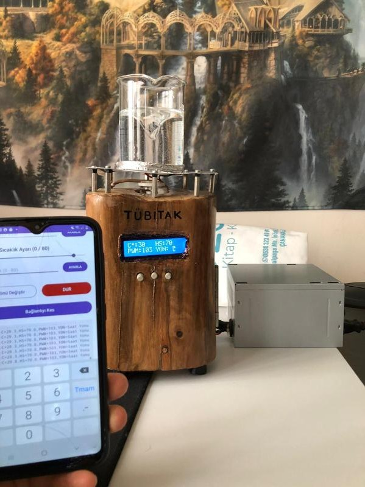

# Hi, I'm Samet Gürhan

### Software Developer @ Trinex · ERP & Web Development · .NET / Blazor · Java / Spring · Android

I build business software that people actually use — custom ERP screens, accounting integrations, POS interfaces, and the web apps and SQL behind them. I like taking a messy real-world process and turning it into a screen that just works.

## About Me

- 🎓 Computer Engineering — Çanakkale Onsekiz Mart University.
- 💼 Software developer at **Trinex Yazılım**, building on the Trinex Cloud ERP platform for manufacturing and retail customers.
- 🌐 Most of my work is **web development**: from ASP.NET MVC and Blazor to React and Spring Boot, plus plain HTML/CSS/JS screens inside the ERP.
- 🔗 I enjoy integration work — keeping two systems in sync, mapping fields between different schemas, and making sure no data gets lost on the way.
- 🔧 I also like building things that touch the physical world — my TÜBİTAK-funded device still sits at home and still works.
- 🛡️ Interested in secure software development and cybersecurity (Linux, phishing awareness, ethical hacking).
- 🤖 I've experimented with LLMs only occasionally — one small local project — but my focus is solid, everyday business software.
- 🌍 Based in Gebze/Kocaeli, Türkiye. English: Upper Intermediate · German: Beginner.

## What I'm Working On

### Trinex Cloud ERP — Custom Screens & Integrations

Day-to-day development on a multi-tenant cloud ERP:

- **Accounting integration:** two-way stock and customer/supplier synchronization between Trinex and the DIA accounting system, including key/code matching, updates, and deletes.
- **Custom screens:** HTML/CSS/JavaScript screens embedded in the ERP — a sales-order **POS screen** for a furniture retailer, a **production reporting** screen, and a **process quality control** flow that links work orders to quality records.
- **Page events:** extending standard ERP forms with new actions — e.g. a *Ship Order* flow that turns sales order lines into stock movements with lot numbers, dated documents, and automatic order closing.
- **Data & SQL:** schema discovery, query-based business rules (e.g. preventing a work order from being active at multiple stations at once), and per-customer configuration (product coding, recipes, quote rules).

## University Projects

### Mobile-Controlled Heated Magnetic Stirrer · TÜBİTAK 2209-A

A lab device designed and built as a **TÜBİTAK 2209-A funded** undergraduate research project, developed by team **LabSync** (with Tuğba Keleş, advised by Öğr. Gör. Vildan Bayram).

Magnetic stirrers mix liquids in medical and food labs by spinning a coated magnetic bar ("flea") inside the container — no shaft, no oil drips, no overflow. Ours adds a heating plate and puts the whole device on your phone.

- 📱 **Android app** (Kotlin / Java, Android Studio) controls **speed, temperature, rotation direction, and mode** remotely.
- 🔌 **Electronics** programmed with the Arduino IDE: a controller board drives the heater and the stirring motor, with an on-device LCD showing live values.
- 🔄 Supports **bidirectional rotation** and **multiple speed levels**, with digital, display-driven control instead of analog knobs.
- 🏆 Presented at the **29th ÇOMÜ Science, Culture & Sports Festival**, evaluated under TÜBİTAK, and **qualified for investment support**.
- 🧪 The finished prototype still sits at home — and still works.

 

### Gebze Municipality Web Platform · Internship Project (2025)

- Built a municipality website and its **admin panel** with a Scrum team, using **React, JavaScript/TypeScript, and Spring Framework**.
- Repo: [GebzeBelediyesiClone](https://github.com/SametGurhan/GebzeBelediyesiClone)

### Research Assistance · İşkur Youth Program, ÇOMÜ Faculty of Engineering (2026)

- Supported graduate research in the Electrical & Electronics Engineering department.

## Featured Repositories

| Project | What it is | Stack |
|---|---|---|
| [Project_ERP](https://github.com/SametGurhan/Project_ERP) | ERP & inventory system with MRP, dynamic price lists, automated invoicing, and ML-based stock forecasting | Python · Streamlit · SQLite · scikit-learn |
| [planstrator-app](https://github.com/SametGurhan/planstrator-app) | My first to-do / planning web app | JavaScript |
| [OtobusBileti_viaDevExBlazorWeb](https://github.com/SametGurhan/OtobusBileti_viaDevExBlazorWeb) | Bus ticket website with seat selection, payment, and confirmation flows | C# · Blazor · DevExpress |
| [Northwind.Blazor.StajKomisyonuEklentisi](https://github.com/SametGurhan/Northwind.Blazor.StajKomisyonuEklentisi) | Internship-committee CRUD module added to the Northwind web app | C# · Blazor |
| [Spring Boot + PostgreSQL CRUD](https://github.com/SametGurhan/Add-CRUD-operations-with-PostgreSQL-integration-in-Spring-Boot) | REST API with full CRUD, tested with Postman | Java · Spring Boot · PostgreSQL |
| [DogusBlogSite](https://github.com/SametGurhan/DogusBlogSite) | Blog website with database integration | ASP.NET MVC |
| [AndroidStudioMiniProjects](https://github.com/SametGurhan/AndroidStudioMiniProjects) | Small Android practice apps | Kotlin |
| [Csharp_kutuphane_otomasyonu](https://github.com/SametGurhan/Csharp_kutuphane_otomasyonu) | Library automation with admin/user roles | C# · WinForms |

Earlier C# WinForms projects include a [traffic racing game](https://github.com/SametGurhan/C-_Trafik_yaris_oyunu_WindowsForms), a [maze game](https://github.com/SametGurhan/Labirent), and an [Access-backed bus ticket automation](https://github.com/SametGurhan/Csharp_Acces_bagintili_Otobus_bileti_otomasyonu).

## Experience

- **Software Developer** — Trinex Yazılım *(current)*
- **Intern** — Bilginet Yazılım Bilişim A.Ş. *(2026)* · ERP processes and software development
- **Intern** — Gebze Municipality IT Department *(2025)* · React, TypeScript, Spring, Scrum
- **İşkur Youth Program** — ÇOMÜ Faculty of Engineering *(2026)*

## Tech Stack

**Languages**

**Web & Backend**

**Mobile, Data & Tools**

**Ways of Working**

## Let's Connect

I'm interested in **ERP systems, web development, and integrations** that make companies run smoother. If you have a project, role, or collaboration in mind, feel free to reach out.

- **Email:** samet.gurhan17@gmail.com
- **LinkedIn:** [linkedin.com/in/sametgurhan](https://www.linkedin.com/in/sametgurhan/)

Turning real business processes into working software, one screen at a time.
